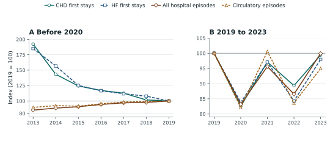
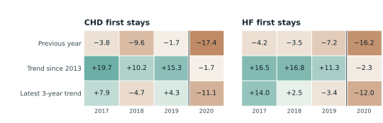

# First hospitalisations after cardiovascular diagnosis and hospital use in Hong Kong

*Diverging trends before 2020 and shared annual declines and rebounds through 2023*

*Coauthor-review manuscript · Laidlaw Scholars Programme, The University of Hong Kong · 19 November 2026*

## Abstract

We compared first recorded stays after coronary heart disease (CHD) or heart failure (HF) diagnosis among people with type 2 diabetes or hypertension with annual inpatient activity across Hong Kong before and during the COVID-19 pandemic. The series contained 156,156 CHD-associated stays and 29,681 HF-associated stays over 2013–2023. Across all six annual transitions to 2019, both first-stay counts fell while total hospital episodes rose. CHD and HF counts fell by 48.0% and 45.9%, respectively, as total episodes rose by 17.3%. Across the next four transitions, all three series fell, rose, fell and rose together. In 2020, CHD and HF counts were 17.4% and 16.2% below 2019. They were only 1.7% and 2.3% below extrapolations using the entire preceding trend, but those trends had underpredicted both series at every earlier validation year. In 2023 both first-stay totals approached their 2019 levels. The decline in recorded first stays preceded the years of shared fluctuation. The comparison documents changes in recorded use. Establishing changes in patient risk requires the time each population remained eligible for a first stay.

## Introduction

A fall in first hospitalisations can reflect fewer people needing inpatient care. It can also reflect fewer people still eligible to have a first event, or a change in when they are diagnosed or admitted. Distinguishing these explanations matters when hospital systems change how they deliver care. In Hong Kong, Xin and colleagues reported lower hospitalisation and higher out-of-hospital mortality in 2020 [1]. Studies of people with diabetes used defined cohorts to examine cardiovascular outcomes and mortality [2] or linked specialist outpatient care in 2020 to subsequent outcomes through June 2024 [3].

We asked when two recorded first-stay series moved with the wider hospital system and when their trajectories diverged. We used the full eleven years of each series, examined how the 2020 comparison depended on the preceding trend, and assessed what the monthly weather data could contribute to interpretation.

<!-- newpage -->

## Results

### The decline before 2020 occurred during growth in hospital activity

From 2013 to 2019, recorded first stays after a CHD diagnosis fell from 23,830 to 12,396. First stays after an HF diagnosis fell from 4,336 to 2,344. Both fell every year. Over the same six transitions, all-hospital episodes and Hospital Authority (HA) episodes rose every year. All-hospital circulatory episodes rose by 11.6% over the period. The two years ending in 2015 accounted for 73.6% of the six-year decline in CHD counts and 70.4% in HF counts (Table 1).

**Figure 1. Annual first stays and hospital episodes indexed to each series’ 2019 count.** Panel A shows 2013–2019. Panel B repeats 2019 as the reference and expands the vertical scale to make the annual movements visible. First stays follow a relevant diagnosis in the study population. The two episode series cover all hospitals and include repeat admissions and day inpatients. The series can overlap. Table 1 gives the counts.

### All four series moved in the same direction from 2019 to 2023

In 2020, both first-stay counts reached their lowest annual totals. All-hospital episodes fell 16.8% and circulatory episodes fell 17.9% relative to 2019. Across the following three years all four series rose in 2021, fell in 2022 and rose again in 2023. With 2019 indexed to 100, the 2023 values were 99.4 for CHD first stays, 98.0 for HF first stays, 99.9 for all-hospital episodes and 95.0 for circulatory episodes. HA-only episodes followed the same four annual directions and reached 101.4 in 2023.

<!-- newpage -->

### The size of the 2020 shortfall depended on the comparison

For CHD, the 2020 count was 17.4% below the previous year's count, 1.7% below the expanding-history trend and 11.1% below the recent three-year trend. For HF, the corresponding shortfalls were 16.2%, 2.3% and 12.0%. The expanding trend came closest to the 2020 counts. In all three earlier validation years, however, it underpredicted CHD by 10.2–19.7% and HF by 11.3–16.8%, measured against the predicted count. The choice of benchmark affected the magnitude even when all three agreed on the direction (Fig. 2).

**Figure 2. Observed counts relative to each one-year-ahead benchmark.** Each cell is 100 × (observed / benchmark − 1). A negative value means fewer stays than the rule projected. Each rule used only years preceding its target. The 2017–2019 cells show historical performance. The separated 2020 column shows the descriptive stress case. There are three historical checks per rule and outcome.

### A few months supplied half the adjusted variation in extreme-day counts

After adjustment for calendar month and a smooth time trend, the full-series residual variation in monthly hot nights, cold days and very hot days was 25.0%, 45.9% and 29.9% of the corresponding unadjusted variation. Seven, seven and eight of the 132 months, respectively, supplied half the residual sum of squares. In the 48 months from 2020 to 2023, those counts were three, two and three. Concentration describes the weather contrasts available within each calendar design. It does not measure how much a month influenced a fitted hospitalisation coefficient.

The smallest adjusted q-value among the twelve released full-series weather models was 0.192. For example, the HF count ratio per five additional cold days was 1.073 (nominal 95% CI 1.006–1.144). The full-window estimate with an eight-degree-of-freedom time spline was 1.062 (0.994–1.135). The earlier and full windows overlap. Comparing their fitted slopes cannot isolate a change in thermal susceptibility. Table 2 summarises all six exposure designs. The complete model results are available with the article.

## Discussion

The contrast between the two periods changes the interpretation of the 2020 trough. The preceding decline in first stays occurred while the territory handled an increasing number of hospital episodes. A general contraction of hospital activity over 2013–2019 therefore cannot explain the early pattern on its own. In the next four annual transitions, first stays and wider activity moved together through two falls and two rebounds. The official statistics record service adjustments beginning in 2020 and a gradual resumption of services in 2023 [4]. The alignment is compatible with changes in hospital use. Aggregate counts cannot apportion contributions from access, admission practice, recording and underlying illness.

The shortfall also depends on how much of the early decline is carried forward. Fitting the whole preceding trend produced a small 2020 shortfall but missed repeatedly in earlier years as the decline slowed. Treating 2019 as the benchmark gave a much larger shortfall. Three historical validations provide little basis to select either rule as the trajectory that would have occurred without disruption.

A specific measurement question follows from the large counts at the beginning of the series. If a database starts observing someone after an earlier qualifying stay, that person's next recorded stay can be misclassified as their first. In a Norwegian HF registry, varying the available lookback changed estimated temporal trends [7]. The corresponding extraction rules in Hong Kong remain unverified. An analyst with access to the source records could first reproduce the released annual totals, then use the same eligible candidates and calendar months to compare a common, fixed length of prior observation with all available history. An excess that consistently followed an imposed start of observation would support sensitivity to event construction. Differences that persisted after this check would still require investigation of entry, exit, survival and care.

Even the apparent return towards 2019 counts allows more than one interpretation. For each outcome, the ratio of recorded-event rates equals the count ratio divided by the ratio of eligible person-time. A 2023 decline in eligible person-time of 0.59% for CHD or 2.05% for HF, relative to 2019, would yield equal rates in those two years. Larger declines would yield higher recorded-event rates in 2023. These are break-even values. Actual eligible person-time was unavailable.

The system counts include recurrent episodes, day inpatients and patients outside the study population. A 2014 HA coding change reduced the number of episodes with unclassified diagnoses, which complicates early comparisons of the circulatory category [4]. The series use different event definitions and may include some of the same stays. Agreement on direction establishes neither a comparison-group effect nor independent replication. Annual aggregation obscures events within pandemic waves. The weather estimates face a related resolution problem. Daily studies in Hong Kong examined cause-specific HF admissions and overnight heat intensity [5,6]. The monthly first-stay series cannot recover either endpoint. The design diagnostics leave open a weather contribution and show why a period-specific explanation would require stronger evidence.

## Methods

### Population and annual comparison

This ecological study used two released series from the Hong Kong HA covering January 2013 through December 2023. The population comprised people diagnosed with type 2 diabetes and/or hypertension during the study period. The supplied endpoint was the first recorded hospitalisation after the first diagnosis record for the relevant disease. Admission cause, diagnostic codes, overlap between the CHD and HF populations, inclusion of the diagnosis admission itself, lookback and entry or exit rules could not be verified from the aggregate release. No total of unique patients across the two series was calculated.

We joined the eleven calendar-year totals for each outcome to the Census and Statistics Department's annual inpatient discharges and deaths [4]. Table 13.9 supplied all-hospital and circulatory-disease episodes. Table 13.10 supplied the HA-only series. These counts include day inpatients. We excluded the separately listed nursing-home sector. The all-hospital total includes HA, private and correctional hospitals. We checked each year across digest editions and reconciled the three provider groups to the all-hospital total. We indexed each series to its own 2019 value and compared adjacent-year directions. Episode totals were used only for context.

### Historical benchmarks

We compared carry-forward of the last count with two ordinary least-squares regressions of log annual count on year, each including an intercept. One used all preceding years from 2013. The other used the latest three. We exponentiated the predicted log count directly as a geometric-trend benchmark. The fixed rules were applied retrospectively to 2017, 2018 and 2019 with rolling training endpoints, then to 2020. We reported every rule and year for both outcomes. We assigned no sampling intervals or pandemic-effect interpretation to these arithmetic comparisons.

### Environmental measurements and analysis

Meteorological data was obtained from the HKO. The monthly variables included: temperature (mean, minimum, maximum), relative humidity, total rainfall, the number of hot nights (T~min~ ≥ 28°C), the number of very hot days (T~max~ ≥ 33°C), the number of extremely hot days (T~max~ ≥ 35°C), and the number of cold days (T~min~ ≤ 12°C). Monthly mean pollutant levels for nitrogen dioxide (NO~2~), sulfur dioxide (SO~2~), and ozone (O~3~) were obtained from the Hong Kong Environmental Protection Department (EPD). All monthly data were derived by taking the average of daily data in each calendar month.

For the six analysed Hong Kong Observatory (HKO) exposures, threshold indicators were summed as days per month and continuous temperatures were averaged. Rainfall was totalled. Pollutants and influenza were outside the baseline models. For each window, we regressed each exposure on calendar-month indicators and a four-degree-of-freedom natural cubic time spline with window-specific knots. We divided the unweighted residual sum of squares by the sum around the raw mean, then counted the largest squared residuals needed to reach half their total. The full-window correlations between the adjusted exposures were checked against the released R calculations.

The previously fitted single-exposure negative-binomial models used the same calendar controls and a log days-in-month offset. Each coefficient expressed a conditional monthly count ratio per 1°C or per five additional threshold days. We retained all twelve full-window contrasts across both outcomes. Their two-sided, six-lag Newey–West Wald p-values used Benjamini–Hochberg adjustment as one family. Intervals are pointwise. Model objects, actual fitted row counts and the original software versions were unavailable for independent verification. This secondary analysis used released estimates.

## References

1. Xin H, Wu P, Wong JY, et al. Hospitalizations and mortality during the first year of the COVID-19 pandemic in Hong Kong, China. An observational study. *Lancet Regional Health – Western Pacific*. 2023;30:100645. [doi:10.1016/j.lanwpc.2022.100645](https://doi.org/10.1016/j.lanwpc.2022.100645)

2. Youn HM, Hu Z, Park YS, et al. Indirect impact of the COVID-19 pandemic on all-cause mortality and cardiovascular disease among people with diabetes mellitus from Korea and Hong Kong. An interrupted time series analysis. *Health Science Reports*. 2025;8:e71291. [doi:10.1002/hsr2.71291](https://doi.org/10.1002/hsr2.71291)

3. Yau YK, Li M, Quan J, et al. Disrupted specialist outpatient services and alternative modes of service for patients with diabetes mellitus. A population-based, retrospective cohort study in Hong Kong. *Diabetes, Obesity and Metabolism*. 2025;27:6615–6623. [doi:10.1111/dom.70069](https://doi.org/10.1111/dom.70069)

4. Census and Statistics Department, Hong Kong SAR Government. *Hong Kong Annual Digest of Statistics*. Tables 13.9 and 13.10, respectively. Printed pages 380/382 (2019), 384/386 (2021), 372/374 (2024) and 354/356 (2025). Data from the Department of Health and Hospital Authority. [Source tables, pages and cells](../../../research_lab/sources/HK_INPATIENT.md)

5. Goggins WB, Chan EYY. A study of the short-term associations between hospital admissions and mortality from heart failure and meteorological variables in Hong Kong. *International Journal of Cardiology*. 2017;228:537–542. [doi:10.1016/j.ijcard.2016.11.106](https://doi.org/10.1016/j.ijcard.2016.11.106)

6. Guo YT, Chan KH, Qiu H, Wong ELY, Ho KF. The risk of hospitalization associated with hot nights and excess nighttime heat in a subtropical metropolis. A time-series study in Hong Kong, 2000–2019. *Lancet Regional Health – Western Pacific*. 2024;51:101168. [doi:10.1016/j.lanwpc.2024.101168](https://doi.org/10.1016/j.lanwpc.2024.101168)

7. Ødegaard KM, Lirhus SS, Melberg HO, Hallén J, Halvorsen S. A nationwide registry study on heart failure in Norway from 2008 to 2018. Variations in lookback period affect incidence estimates. *BMC Cardiovascular Disorders*. 2022;22:88. [doi:10.1186/s12872-022-02522-y](https://doi.org/10.1186/s12872-022-02522-y)

<!-- newpage -->

## Numerical appendix

**Table 1. Calendar-year counts by event definition.** The two first-stay series cover the supplied study population. The other columns count episodes of inpatient discharge or death. The all-hospital series includes the circulatory and HA episodes. These columns must be read separately.

<!-- annual-table -->

| Year | CHD first stays | HF first stays | All episodes | Circulatory episodes | HA episodes |
| --- | --- | --- | --- | --- | --- |
| 2013 | 23,830 | 4,336 | 1,933,800 | 153,521 | 1,552,627 |
| 2014 | 17,760 | 3,675 | 2,006,993 | 158,516 | 1,614,908 |
| 2015 | 15,411 | 2,934 | 2,056,821 | 156,770 | 1,658,399 |
| 2016 | 14,510 | 2,734 | 2,140,708 | 163,461 | 1,734,674 |
| 2017 | 13,962 | 2,620 | 2,200,404 | 168,577 | 1,809,770 |
| 2018 | 12,616 | 2,527 | 2,216,963 | 169,542 | 1,827,130 |
| 2019 | 12,396 | 2,344 | 2,268,293 | 171,331 | 1,879,483 |
| 2020 | 10,237 | 1,964 | 1,887,178 | 140,696 | 1,597,505 |
| 2021 | 12,035 | 2,275 | 2,169,258 | 172,313 | 1,809,260 |
| 2022 | 11,076 | 1,976 | 1,963,169 | 143,223 | 1,641,002 |
| 2023 | 12,323 | 2,296 | 2,266,303 | 162,691 | 1,905,905 |

<!-- /annual-table -->

**Table 2. Unweighted variation in six monthly exposures after calendar adjustment.** The percentage is adjusted divided by unadjusted variation over 2013–2023. The final three columns give the minimum number of months supplying half of the adjusted sum of squares within each independently fitted calendar window.

<!-- weather-table -->

| Exposure | Variation remaining | 2013–23 (132) | 2013–19 (84) | 2020–23 (48) |
| --- | --- | --- | --- | --- |
| Mean temperature | 3.6% | 13 | 9 | 5 |
| Mean daily maximum | 4.3% | 13 | 9 | 4 |
| Mean daily minimum | 3.9% | 14 | 9 | 5 |
| Hot nights | 25.0% | 7 | 6 | 3 |
| Cold days | 45.9% | 7 | 5 | 2 |
| Very hot days | 29.9% | 8 | 3 | 3 |

<!-- /weather-table -->

### Data and code

The [annual series](../../../research_lab/results/service_context.csv), [24 historical comparisons](../../../research_lab/results/hindcast.csv), [18 exposure diagnostics](../../../research_lab/results/weather_design.csv) and [48 weather interval constructions](../../../research_lab/results/weather_models.csv) are supplied as machine-readable tables. The [earlier supplement](../Supplement_covid_period.md) gives the calendar sensitivities, diagnostic statistics and original model estimates. The Laidlaw Heat Project at The University of Hong Kong provides the analysis code. The data custodian controls the underlying records and monthly outcome files.
